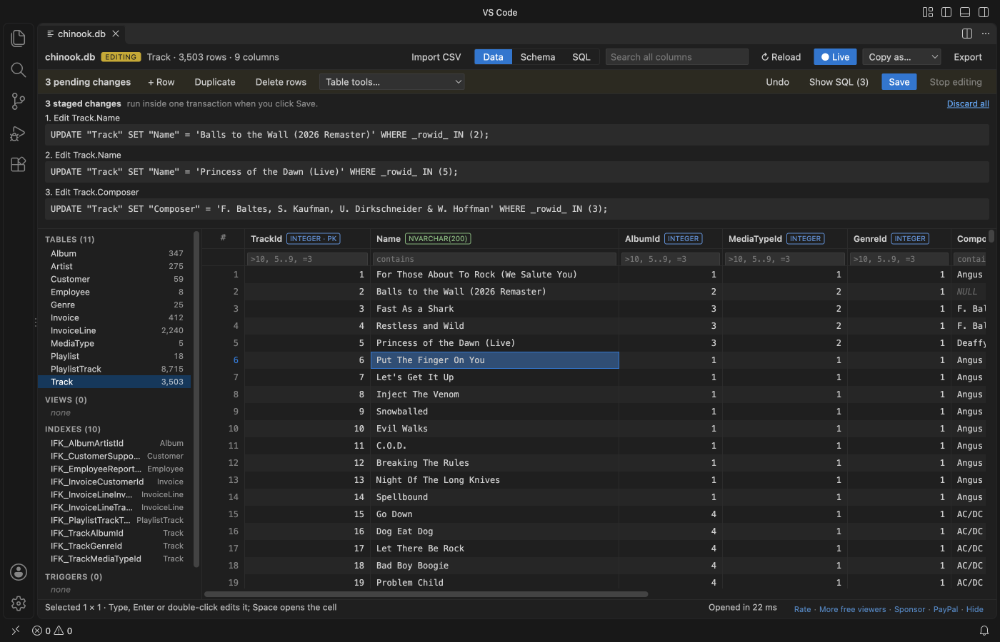
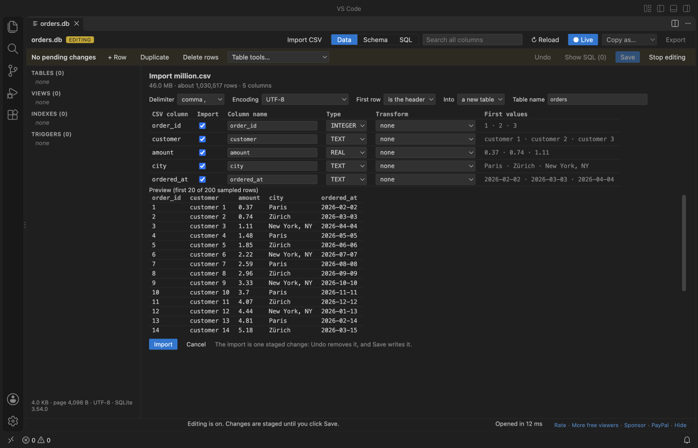
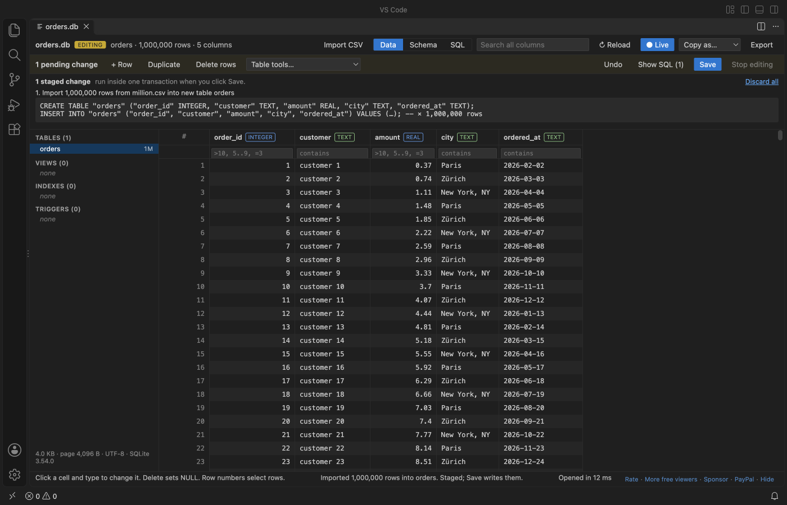
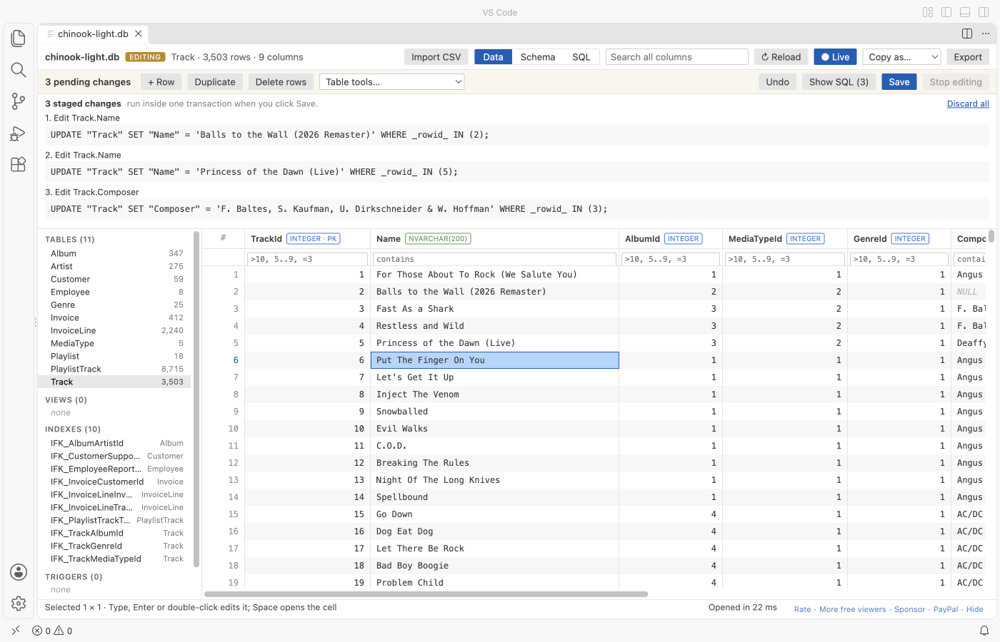

# SQLite Editor & Viewer, SQLite3 Database Browser (Edit Cells, CSV Import)

<a href="https://marketplace.visualstudio.com/items?itemName=zovo.sqlite-table-viewer"></a>
<a href="https://marketplace.visualstudio.com/items?itemName=zovo.sqlite-table-viewer"></a>
<a href="https://github.com/theluckystrike/sqlite-table-viewer/blob/HEAD/LICENSE"></a>

Free, no paywall, no sign-in, works offline. Opening, viewing, editing, Save and CSV import cost nothing, and there is no license banner. Optional Zovo Pro (USD 19 once, all Zovo extensions) adds database compare with a sync script, ER diagrams and export of every table at once. Everything that is free today stays free.

Click a `.db` or `.sqlite` file and it opens read-only. Click Enable editing to change cells and rows, run INSERT or UPDATE, or import a CSV file. Every change waits in a pending list with its SQL and Undo. Save checks the constraints, makes a backup copy and replaces the file in one step.

<a href="https://raw.githubusercontent.com/theluckystrike/sqlite-table-viewer/main/images/edit-dark.png"></a>

*A real VS Code window with the Chinook sample database. Three cells were changed; nothing is on disk until Save.*

- Read-only until you say so. Nothing is written before you click Enable editing and then Save. Before editing starts it tells you when another program has the file open, when the `-wal` file holds transactions that are not in the main file yet, or when a `-journal` shows a write in progress.
- Safe Save. A backup copy first (`name.db.20261109-143000.bak`), then the new file goes to a temp file, is flushed to disk and replaces the old one with a rename. If the file changed on disk since you opened it, Save refuses and keeps your changes.
- CSV and TSV import. 1,000,000 rows import in about 2 seconds with a progress bar and Cancel. Pick the delimiter, encoding and header row, map the columns, then Save.
- Sees the `-wal` file and reloads live while your app writes, as before.
- No network. Plain JavaScript and SQLite compiled to WebAssembly, running in VS Code. No telemetry.

## Quick start

1. Install SQLite Editor & Viewer.
2. Click any `.db`, `.sqlite`, `.sqlite3`, `.db3`, `.s3db`, `.sl3`, `.vscdb` or `.gpkg` file. It opens as a table, read-only.
3. To change it, click Enable editing. Double-click a cell (or press Enter, F2, or just type), change it, press Enter. Press Save (Ctrl+S or Cmd+S) when you are done.

To make a new database from a CSV file, right-click the `.csv` file in the Explorer and pick Import CSV into a new SQLite database.

## Editing

| Action | How |
|---|---|
| Change a cell | Double-click, Enter, F2 or type. Enter saves the cell and moves down, Tab moves right, Esc cancels. |
| Set NULL | Select one cell and press Delete. |
| Long text, JSON, BLOB | Space opens the cell panel. Pick TEXT, INTEGER, REAL, NULL or BLOB (hex), or Load file into cell. Save BLOB to file writes a BLOB out. |
| Add, copy, remove rows | + Row, Duplicate, Delete rows (or click row numbers and press Delete). A new row fills NOT NULL columns, and a NOT NULL foreign key gets an existing parent key. |
| SQL | INSERT, UPDATE, DELETE, REPLACE, CREATE, DROP and ALTER run in the SQL tab as staged changes. BEGIN, COMMIT, ATTACH and VACUUM do not: the editor owns the transaction. |
| Table tools | Add, rename and drop columns, rename a table, find and replace in a column. |
| Undo | Undo (Ctrl+Z or Cmd+Z in the grid) takes back the last change. Show SQL lists every staged statement, Discard all drops them. |

Values are stored the way the column asks: typing `42` into an INTEGER column stores the number 42, `007` stays text, and a 64-bit integer keeps every digit. A CHECK, NOT NULL, UNIQUE or foreign key error refuses only that one change and says which constraint it was. Your other pending changes stay.

### What Save does

1. Looks at the file again. If its size, modified time or header changed since it was loaded, Save stops: another program wrote to it.
2. Stops when the `-wal` file holds committed frames or a hot `-journal` exists. "Checkpoint and reload" runs `PRAGMA wal_checkpoint(TRUNCATE)` with the sqlite3 tool when it is installed.
3. Checks foreign keys (`PRAGMA foreign_key_check`) and runs `PRAGMA quick_check`. A deferred foreign key that breaks is named with its table and row.
4. Copies the file to `name.db.YYYYMMDD-HHMMSS.bak` next to it, or to `~/.zovo-sqlite-backups` (setting `sqliteTableViewer.backupLocation`).
5. Writes the new database to a temp file in the same folder, flushes it to disk, and renames it over the original. A WAL-mode database stays in WAL mode.

A crash at any point leaves the old file or the new one, never half of each. The tests open every saved file in the sqlite3 tool and run `PRAGMA integrity_check`.

## Import CSV and TSV

<a href="https://raw.githubusercontent.com/theluckystrike/sqlite-table-viewer/main/images/import-preview-dark.png"></a>

- Import CSV in the toolbar adds a table to the open database, or adds rows to an existing table (CSV columns map to table columns by name).
- The preview shows the first 200 rows. The delimiter (comma, semicolon, tab, pipe), the encoding (UTF-8, Windows-1252, UTF-16) and the header row are guessed and can be changed. Column types are guessed as INTEGER, REAL or TEXT, and values with leading zeros (ZIP codes, IDs) stay TEXT.
- Quoted fields with commas, doubled quotes and line breaks inside quotes are read correctly.
- The file is read in 1 MB pieces, so a large file never sits in memory as text. The progress bar shows rows and bytes, and Cancel rolls everything back.
- A row that breaks a constraint stops the import at its line number and adds nothing.
- The whole import is one staged change: Undo removes it, Save writes it.

<a href="https://raw.githubusercontent.com/theluckystrike/sqlite-table-viewer/main/images/import-done-dark.png"></a>

*1,000,000 rows (46 MB of CSV) imported in a real VS Code window in about 2 seconds, then saved. The grid stayed responsive the whole time.*

## Why this one

People who use SQLite tools in VS Code have reported these problems. The right column says how this extension behaves, and which test checks it.

| Reported problem | Link | Here |
|---|---|---|
| A paid tier blocks basic use: "paywall makes it really bad, can't even open the db" (September 2026), "Says it's free but it's not free" (September 2026). | [Marketplace reviews of a popular SQLite viewer](https://marketplace.visualstudio.com/items?itemName=qwtel.sqlite-viewer&ssr=false#review-details) | Opening, viewing, editing, Save and CSV import are free, with no account and no license banner. |
| Changes reached the disk only after the editor tab was closed. | [sqlite3-editor issue 87](https://github.com/yy0931/sqlite3-editor/issues/87) | Save writes the file at once. The real VS Code test opens the file in the sqlite3 tool right after Save and finds the new values and `integrity_check` ok. |
| Opening a database locked it, so the app that owns it got "attempt to write a readonly database". | [sqlite3-editor issue 60](https://github.com/yy0931/sqlite3-editor/issues/60) | The file is read into memory and closed. Another program can keep writing while it is open, and the view reloads. The test writes to the file from the sqlite3 tool during an edit. |
| A database was reported damaged after it was opened in an editor while it was in use. | [sqlite3-editor issue 49](https://github.com/yy0931/sqlite3-editor/issues/49) | Read-only until Enable editing. Save refuses a file that changed, a `-wal` with pending transactions and a hot journal, makes a backup, and replaces the file atomically. |

## Free and Zovo Pro

Everything in the sections above is free and stays free: opening, reading, the SQL tab, editing cells and rows, Save with a backup, CSV and TSV import with column transforms, the table tools, and export of the rows in view. There is no trial timer and no license banner, and nothing about Pro shows when a database opens.

Zovo Pro is USD 19 once and unlocks the Pro tools in every Zovo extension. It adds three tools for work across a whole database. Each one can be used 3 times for free on each computer. A try counts only when the tool wrote its files; Escape or an error costs nothing. After that, starting the tool shows one dialog with the ways to unlock: the "$19 one time" tier on GitHub Sponsors, PayPal (you get a license key), or a key you already have.

Start them from the DB tools button (with a small PRO badge) in the editor, the Command Palette, or a right-click on a database file in the Explorer.

| Pro tool | What you get |
|---|---|
| Compare with another database | Tables, columns, indexes, views, triggers and rows of two SQLite files, with rows matched by primary key (or rowid). A Markdown report with counts and the first differences of each table, and `a-vs-b-sync.sql`, a script that makes the second database match the first. The script is opened in an editor and never run for you. |
| ER diagram and schema document | `name-er.svg` (tables, columns, keys and a line for each foreign key), `name-er.mmd` (Mermaid `erDiagram`, renders on GitHub) and `name-schema.md` with every table, column, key, index, trigger and view. |
| Export all tables | One Excel workbook with a sheet per table (bold, frozen header row), or a folder with one CSV file per table. |

The setting `sqliteTableViewer.showProFeatures` set to `false` hides the button and the Pro commands. Both databases are only read; the tools never write to a database file.

## Large files

The whole database is loaded into memory. Files up to 512 MB open (setting `sqliteTableViewer.maxFileSizeMB`), and rows are fetched one page at a time, so a table with millions of rows scrolls as fast as a small one. Editing is limited to 256 MB (setting `sqliteTableViewer.editMaxFileSizeMB`), because Save needs a second copy in memory. A larger file stays open read-only and says so. In the real VS Code test a 301 MB database with 1,000,000 rows opened in under 2 seconds and scrolled to its last row.

## Reading

Pick a table or view on the left. Click a column header to sort, type under a header to filter (`>10`, `5..9`, `=word`, `!word`, `empty`), or search every column at once. Filter values are bound parameters, never pasted into the SQL text.

When a database is in WAL mode, new transactions sit in `name.db-wal` until a checkpoint. This viewer reads the committed transactions from the `-wal` file, the way SQLite does, and a blue line says how many came from it. It checks the database and its `-wal` once a second and reloads with the same table, sort, filters and scroll position (the Live button turns this off). While editing is on, it does not reload. It shows a notice instead.

The Schema tab shows columns, keys, foreign keys and the CREATE statements. The SQL tab runs one statement at a time with a history of the last 20. The cell panel shows JSON as a tree, images as pictures and float32 BLOBs as vectors. Copy as puts the selection on the clipboard as CSV, TSV, JSON or INSERT statements. Export saves every row in view as CSV, JSON or SQL INSERT statements.

<a href="https://raw.githubusercontent.com/theluckystrike/sqlite-table-viewer/main/images/edit-light.png"></a>

## Settings

| Setting | Default | What it does |
|---|---|---|
| `sqliteTableViewer.maxFileSizeMB` | `512` | Larger files show a message instead of loading |
| `sqliteTableViewer.editMaxFileSizeMB` | `256` | Larger files open read-only; Enable editing says why |
| `sqliteTableViewer.backupLocation` | `nextToFile` | `nextToFile` or `homeFolder` (`~/.zovo-sqlite-backups`) |
| `sqliteTableViewer.enforceForeignKeys` | `true` | While editing, `PRAGMA foreign_keys = ON`, and Save checks every foreign key |
| `sqliteTableViewer.copyMaxRows` | `100000` | Most rows copied to the clipboard at once |
| `sqliteTableViewer.exportMaxRows` | `1000000` | Most rows written to one export |
| `sqliteTableViewer.autoReload` | `true` | Reload when the database or its `-wal` file changes (not while editing) |
| `sqliteTableViewer.askForRating` | `true` | Ask for a rating at most twice, never after an error |
| `sqliteTableViewer.showProFeatures` | `true` | Show the Zovo Pro tools and license commands; `false` hides them unless Pro is unlocked |
| `sqliteTableViewer.compareMaxStatements` | `1000000` | Compare: the sync script stops (and rolls back) after this many statements |

## Limits

- Editing works for files on this computer. Files on remote or virtual file systems open read-only.
- If you close the tab with unsaved changes, they are dropped and the file stays as it was. A notice says so.
- Encrypted databases (SQLCipher, SEE) cannot be opened. They get a clear message, and so do damaged files and files that are not SQLite.
- The `-shm` file is not read. It only speeds up the app that owns the database.

## Privacy

No network requests and no telemetry. The only exception is a click you make on a Zovo Pro unlock button: GitHub Sponsors asks VS Code for your GitHub sign-in and sends one request to GitHub, and the buy buttons open a page in your browser. The database is read and edited in a worker thread on your computer. Two local tools may run: `lsof` (macOS and Linux) to see whether another program has the file open before editing and saving, and `sqlite3` only when you click "Checkpoint and reload". The webview runs under a strict Content Security Policy with no remote scripts, and every value from the file is written as plain text, never as HTML.

## Development

```sh
npm install
npm test          # builds with esbuild, then node --test, incl. a 1,000,000-row CSV import and save
npm run package   # writes dist/sqlite-table-viewer-<version>.vsix
```

## Support Zovo

Zovo extensions are free, with no ads and no tracking. They are made by [theluckystrike](https://github.com/theluckystrike) on GitHub. If this one saves you time, you can support the work:

- [Sponsor on GitHub](https://github.com/sponsors/theluckystrike)
- [PayPal](https://www.paypal.com/paypalme/najzzz)
- [Follow theluckystrike on GitHub](https://github.com/theluckystrike)

### Need your format supported?

Open a [format request](https://github.com/theluckystrike/sqlite-table-viewer/issues/new?template=format-request.yml) with a sample file, and I reply there whether it can be done. For USD 299 once, through [this GitHub Sponsors tier](https://github.com/sponsors/theluckystrike/sponsorships?tier_id=679995), I add your file format or a missing feature to this extension, with tests, within 7 days.

## More tools by Zovo

- [XLSX Viewer & CSV Preview for Excel, XLS & Parquet](https://marketplace.visualstudio.com/items?itemName=zovo.table-viewer-vscode) opens CSV, TSV, Excel and Parquet files as a sortable, filterable table.
- [Large JSON Viewer, JSON Browser & JSON Tree](https://marketplace.visualstudio.com/items?itemName=zovo.zovo-json-tree-viewer) shows large JSON files as a searchable tree, copies JSONPath and turns arrays of objects into a table.
- [Avro Viewer, Apache Arrow Viewer & Feather Viewer](https://marketplace.visualstudio.com/items?itemName=zovo.arrow-avro-viewer) opens Avro, Arrow and Feather files as a paged table.
- [JSONL Viewer, Large JSONL Table & NDJSON Viewer](https://marketplace.visualstudio.com/items?itemName=zovo.zovo-jsonl-viewer) opens JSONL and NDJSON files as a table, as records or as a chat view.
- [GeoJSON Viewer, KML Viewer & GPX Viewer (Map Preview, Shapefile)](https://marketplace.visualstudio.com/items?itemName=zovo.zovo-geo-map-viewer) GeoJSON viewer, KML viewer and GPX viewer with a map preview in VS Code. Also opens shapefiles (SHP, zipped), KMZ, TopoJSON, WKT and CSV with lat/lon: feature table, properties, GPX distance and elevation profile, reprojection from .prj, PNG export. Free, no sign-in, works offline.

See [all Zovo extensions on the Marketplace](https://marketplace.visualstudio.com/publishers/zovo).

## License

MIT. sql.js is MIT and SQLite is public domain. See [THIRD-PARTY-NOTICES.txt](https://github.com/theluckystrike/sqlite-table-viewer/blob/HEAD/THIRD-PARTY-NOTICES.txt).
