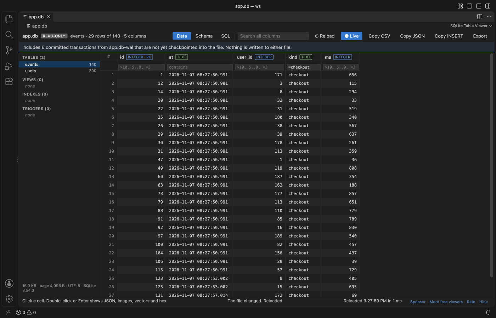
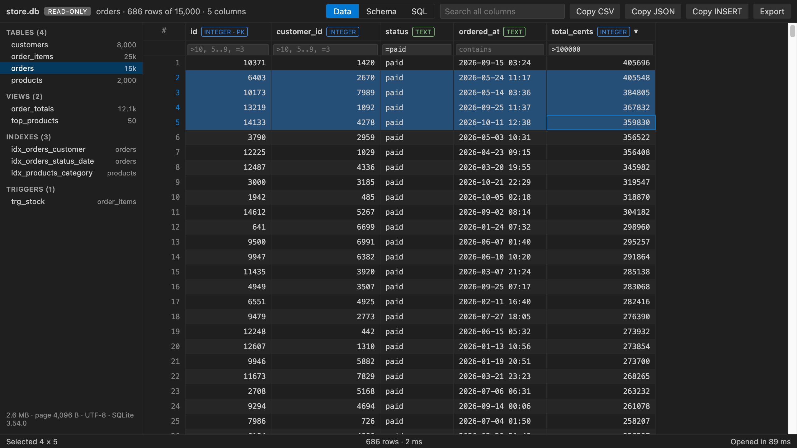
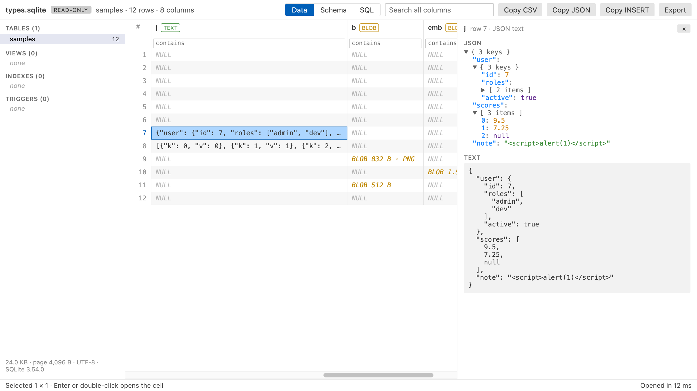
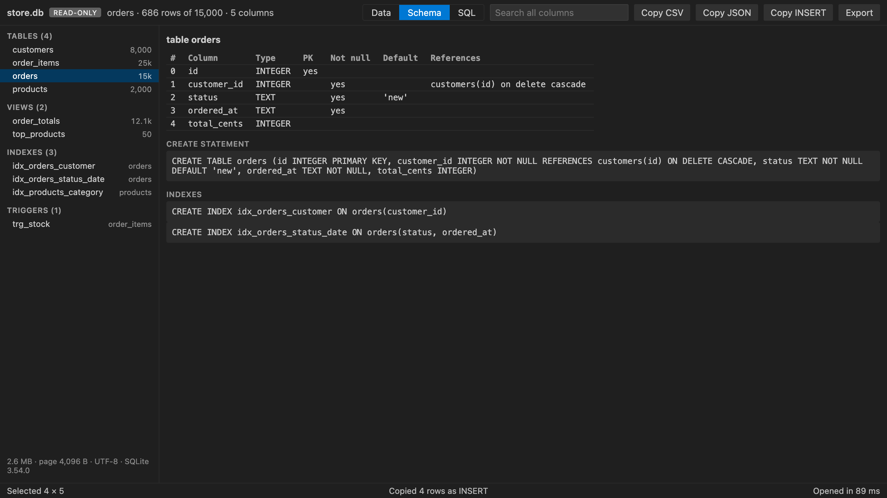
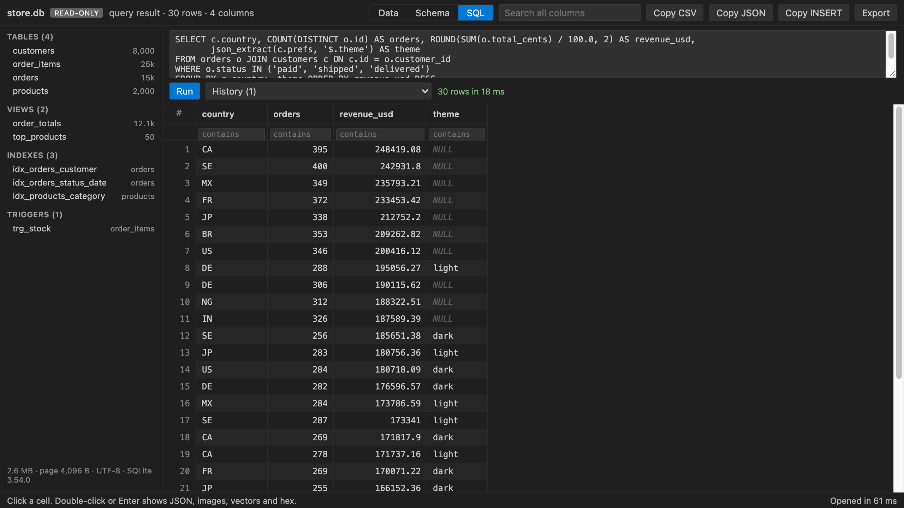
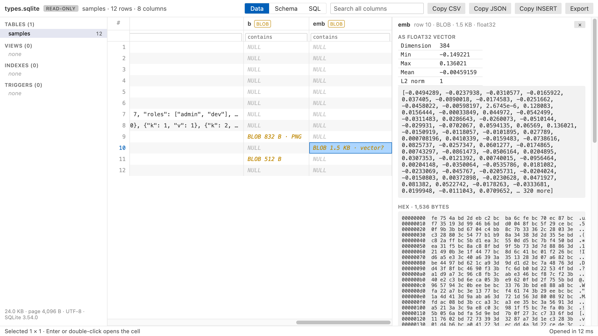

# SQLite Viewer & DB Viewer, Database Viewer (Read-Only)

<a href="https://marketplace.visualstudio.com/items?itemName=zovo.sqlite-table-viewer"></a>
<a href="https://marketplace.visualstudio.com/items?itemName=zovo.sqlite-table-viewer"></a>
<a href="https://github.com/theluckystrike/sqlite-table-viewer/blob/HEAD/LICENSE"></a>

Click a `.db` or `.sqlite` file and this SQLite viewer shows its tables, schema, JSON columns and BLOBs in a fast read-only grid. It also shows the rows your app has not checkpointed yet, and it updates while the app writes. Free, with no paid tier and no file size paywall.

<a href="https://raw.githubusercontent.com/theluckystrike/sqlite-table-viewer/main/images/vscode-live-wal.png"></a>

*A real VS Code 1.142 window. A Python script holds `app.db` open in WAL mode and keeps inserting rows, and the grid follows it.*

- Sees the rows still in the `-wal` file. Many apps (Django, Rails, Prisma, Electron apps, browsers) keep new rows in `name.db-wal` until a checkpoint, so other viewers show old data or no tables at all. This one reads the committed transactions from the `-wal` file, the way SQLite does.
- Live. When the app writes, the view reloads by itself and keeps your table, sort, filters and scroll position.
- Safe for production files. The database loads into memory read-only. Writes are refused by SQLite itself (`PRAGMA query_only`), and nothing is ever saved back, to the database or to the `-wal` file.
- Sees inside cells. JSON text opens as a tree. PNG, JPEG, GIF and WebP BLOBs show as pictures. A float32 embedding shows its dimension, min, max and norm, which helps with sqlite-vec and RAG tables.
- No setup, no network. Plain JavaScript and SQLite compiled to WebAssembly, running offline in VS Code. No telemetry.

## Quick start

1. Install SQLite Viewer.
2. Click any `.db`, `.sqlite`, `.sqlite3`, `.db3`, `.s3db`, `.sl3`, `.vscdb` or `.gpkg` file. It opens as a table.

A SQLite file with another name (`.data`, `.store`, no extension) is detected by its "SQLite format 3" header, and VS Code offers to open it here. You can also right-click any file and pick "Open in SQLite Table Viewer".

## More screenshots

<a href="https://raw.githubusercontent.com/theluckystrike/sqlite-table-viewer/main/images/orders-dark.png"></a>

*store.db, a generated shop database with 50,000 rows (scripts/make-samples.py), filtered and sorted. It opened in 57 ms.*

| JSON column as a tree, light theme | Schema tab, dark theme |
|---|---|
| <a href="https://raw.githubusercontent.com/theluckystrike/sqlite-table-viewer/main/images/json-tree-light.png"></a> | <a href="https://raw.githubusercontent.com/theluckystrike/sqlite-table-viewer/main/images/schema-dark.png"></a> |

| SQL box with history, dark theme | Float32 embedding, light theme |
|---|---|
| <a href="https://raw.githubusercontent.com/theluckystrike/sqlite-table-viewer/main/images/sql-dark.png"></a> | <a href="https://raw.githubusercontent.com/theluckystrike/sqlite-table-viewer/main/images/vector-light.png"></a> |

## What you can do

Pick a table or view on the left. Each one shows its row count. Indexes and triggers are listed too, and a click shows their SQL.

Click a column header to sort. Clicks cycle through ascending, descending and the table's own order, and NULLs go last. Type in the box under a header to filter that column. Number columns take `>10`, `>=10`, `<5`, `!=3` and ranges like `5..9`. Text matches any part of the value, `=word` matches exactly and `!word` drops rows that contain it. `empty` and `!empty` work everywhere. The search box looks in every column. Every filter value is sent to SQLite as a bound parameter, never pasted into the SQL text.

## WAL files and live reload

When a database is in WAL mode, SQLite writes new transactions to `name.db-wal` first and copies them into `name.db` later, at a checkpoint. A viewer that reads only `name.db` misses those rows, and a table made since the last checkpoint is not there at all. This viewer reads both files. Only complete, committed transactions are used: frames are checked with the WAL salts and checksums, and a half-written transaction at the end is skipped. A blue line above the grid says how many transactions came from the `-wal` file. If the `-wal` file can't be used, a yellow line says so and the main file is shown.

The viewer checks the database and its `-wal` file once a second. When either changes, it reads them again and shows the same table with the same sort, filters, scroll position and open cell. The "Live" button in the toolbar turns this off (setting `sqliteTableViewer.autoReload`). Then a line says "The file changed on disk" with a Reload button. "Reload" in the toolbar reads the files again at any time. If a reload happens in the middle of a write and fails, the old view stays and the viewer tries once more.

Rows are fetched one page at a time, so a table with millions of rows scrolls as fast as a small one.

The Schema tab shows each column's declared type, primary key, NOT NULL, default and foreign key, plus the CREATE statements for the table, its indexes and its triggers.

The SQL tab runs one statement at a time. SELECT, WITH, VALUES, EXPLAIN and reading PRAGMAs (`table_info`, `index_list`, `integrity_check` and so on) are allowed. The result fills the same grid, so you can sort, filter and copy it. You see the row count and the time, and the last 20 queries stay in the history list.

Double-click a cell, or press Enter, to open the cell viewer. Text and JSON show in full. A BLOB shows its size and a hex dump, plus the picture for image data and vector stats when the bytes decode as float32 or float64.

Select cells by dragging or with Shift+click, or click row numbers for whole rows. Copy CSV, Copy JSON and Copy INSERT put the selection on the clipboard, and Ctrl+C (Cmd+C on macOS) copies tab-separated values. Export saves every row in view, filtered and sorted, as CSV or JSON.

## Settings

| Setting | Default | What it does |
|---|---|---|
| `sqliteTableViewer.maxFileSizeMB` | `512` | Larger files show a message instead of loading |
| `sqliteTableViewer.copyMaxRows` | `100000` | Most rows copied to the clipboard at once |
| `sqliteTableViewer.exportMaxRows` | `1000000` | Most rows written to one CSV or JSON export |
| `sqliteTableViewer.autoReload` | `true` | Reload the view when the database or its `-wal` file changes. Turn it off with `false` to get a Reload notice instead |
| `sqliteTableViewer.askForRating` | `true` | Ask one time for a Marketplace rating, after 5 databases and 2 days. Turn it off with `false` |

## Limits

- The whole file is loaded into memory, so files over 512 MB show a message instead (setting `sqliteTableViewer.maxFileSizeMB`).
- Read-only by design. Editing rows is not supported.
- The `-shm` file is not read. It only speeds up the app that owns the database; the `-wal` file holds the data.
- Encrypted databases (SQLCipher, SEE) cannot be opened. They get a clear message, and so do damaged files and files that are not SQLite at all.
- Row counts for files over 100 MB come from `sqlite_stat1` when it exists. Otherwise a "count" button counts on demand.

## Privacy

SQLite Table Viewer makes no network requests and collects no telemetry. The database is read in a worker thread on your machine. The webview runs under a strict Content Security Policy with no remote scripts, and every value from the file is written as plain text, never as HTML.

## Development

```sh
npm install
npm test          # builds with esbuild, makes sample databases in a temp folder, runs node --test
npm run samples   # writes the sample databases to samples/ (Python standard library only)
npm run package   # writes dist/sqlite-table-viewer-<version>.vsix
```

The screenshots come from `scripts/screenshot/live.js`, which serves the real webview page and drives it over the Chrome DevTools Protocol.

## Support Zovo

Zovo extensions are free, with no ads and no tracking. They are made by [theluckystrike](https://github.com/theluckystrike) on GitHub. If this one saves you time, you can support the work:

- [Sponsor on GitHub](https://github.com/sponsors/theluckystrike)
- [Follow theluckystrike on GitHub](https://github.com/theluckystrike)

## More tools by Zovo

- [CSV Viewer, Excel Viewer (XLSX) & Parquet Viewer](https://marketplace.visualstudio.com/items?itemName=zovo.table-viewer-vscode) opens CSV, TSV, Excel and Parquet files as a sortable, filterable table.
- [Large JSON Viewer & JSON Tree](https://marketplace.visualstudio.com/items?itemName=zovo.zovo-json-tree-viewer) shows large JSON files as a searchable tree, copies JSONPath and turns arrays of objects into a table.
- [Avro Viewer, Arrow Viewer & Feather Viewer](https://marketplace.visualstudio.com/items?itemName=zovo.arrow-avro-viewer) opens Avro, Arrow and Feather files as a paged table.
- [JSONL Viewer & NDJSON Viewer (JSONL Table)](https://marketplace.visualstudio.com/items?itemName=zovo.zovo-jsonl-viewer) opens JSONL and NDJSON files as a table, as records or as a chat view.
- [HDF5 & NetCDF Explorer (H5 Viewer)](https://marketplace.visualstudio.com/items?itemName=zovo.hdf5-netcdf-explorer) browses groups, attributes and values in HDF5 and NetCDF files and plots slices.

See [all Zovo extensions on the Marketplace](https://marketplace.visualstudio.com/publishers/zovo).

## License

MIT. sql.js is MIT and SQLite is public domain. See [THIRD-PARTY-NOTICES.txt](https://github.com/theluckystrike/sqlite-table-viewer/blob/HEAD/THIRD-PARTY-NOTICES.txt).
